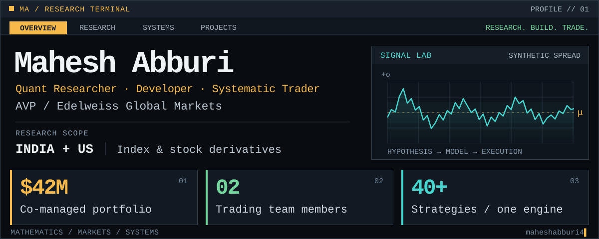
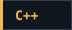
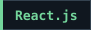
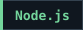
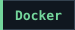
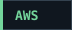

<picture>
  <source media="(max-width: 600px)" srcset="terminal-header-mobile.svg">
  
</picture>

<p>
  <a href="https://maheshabburi4.netlify.app"></a>
  <a href="https://www.linkedin.com/in/maheshabburi4/"></a>
  <a href="mailto:maheshabburi4@gmail.com"></a>
</p>

**Quantitative Researcher, Developer & Systematic Trader at Edelweiss Global Markets.**  
I connect mathematical ideas with systems that have to behave in production. Research is the hypothesis. Code is where it meets reality.

### `01 / DESK NOTES`

<details>
<summary><strong>CURRENT</strong> &nbsp; Quantitative research → systematic trading</summary>

- Pairs trading and regime-aware ML position sizing across Indian derivatives, with ongoing research into US index and stock derivatives.
- Correlation-matrix, OI and IV-skew features, feature selection, model selection and hyperparameter tuning.
- Centralized execution with cross-strategy hedging, self-trade avoidance, and shared portfolio risk and margin controls.

</details>

<details>
<summary><strong>PREVIOUS</strong> &nbsp; Infurnia → cloud-native C++ & geometric modelling</summary>

- Led core technology development, including parametric models with **100+ construction rules and constraints**.
- Built incremental versioning and concurrent systems, contributing to an **87% improvement in overall software performance**.

</details>

<details>
<summary><strong>FOUNDATION</strong> &nbsp; IIT Hyderabad → Computer Science + Electrical Engineering</summary>

B.Tech. in Computer Science with a second major in Electrical Engineering. **Overall GPA: 8.95/10.**

Former Teaching Assistant and Technical Head of **ELAN & ηVision**, IIT Hyderabad’s annual fest. Organized **10+ technical workshops** and hosted **12 technical competitions**.

</details>

### `02 / PROJECT BOOK`

Academic builds, with the source attached.

| Project | Research & engineering notes |
| :--- | :--- |
| **[ML Kaggle Hackathon](https://github.com/maheshabburi4/IITH-BTECH-Courses/blob/master/Sem%205/CS5590%20-%20FOML/Assignments/Hackathon/CS18BTECH11001-iith-foml-2020.zip)** | 18-class classification, feature reduction and tuned ensembles. **2nd public leaderboard · 0.95305 public score.** |
| **[Reliable UDP Transfer](https://github.com/maheshabburi4/IITH-BTECH-Courses/tree/master/Sem%206/CS3543%20-%20CN2/Assignments)** | Loss detection and fast retransmission. **9× speedup** in the course simulation at 100 Mbps, 50 ms delay and 5% packet loss. |
| **[Concurrency & Parallel Graphs](https://github.com/maheshabburi4/IITH-BTECH-Courses/tree/master/Sem%205/CS5300%20-%20PCP)** | Queue locks, synchronized sets and OpenMP Prim’s algorithm. More threads. More questions. |
| **[Statistical Estimation](https://github.com/maheshabburi4/IITH-BTECH-Courses/tree/master/Sem%205/CS5590%20-%20FOML/Assignments/Assignment%201)** | MLE/MAP derivations, Poisson regression and L1/L2 regularization. Mathematics carried into code. |

[All coursework →](https://github.com/maheshabburi4/IITH-BTECH-Courses) &nbsp;·&nbsp; [Project case studies →](https://maheshabburi4.netlify.app/#projects)

### `03 / TOOLCHAIN`

**Research & data**

<p>
  
  
  
  
</p>

**Systems & geometry**

<p>
  
  
  
</p>

**Applications & infrastructure**

<p>
  
  
  
  
  
</p>

### `04 / OFFLINE MODE`

Badminton, the gym, and experiments that were supposed to take five minutes.

```text
mahesh@research-desk:~$ ./next_question
> The market has no obligation to respect my code.
```
