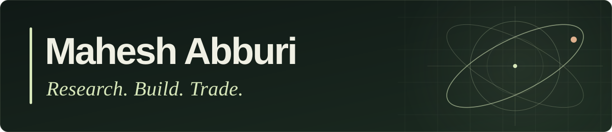

  <strong>Quantitative Researcher, Developer &amp; Systematic Trader</strong> 
  Assistant Vice President at <strong>Edelweiss Global Markets</strong>

  <a href="https://maheshabburi4.netlify.app"><strong>Portfolio ↗</strong></a> &nbsp;·&nbsp;
  <a href="https://www.linkedin.com/in/maheshabburi4/">LinkedIn</a> &nbsp;·&nbsp;
  <a href="mailto:maheshabburi4@gmail.com">Email</a>

Hi, I’m Mahesh. I turn mathematical ideas into research, trading strategies, and software that has to work beyond the notebook. My interests sit where **mathematics, markets, and systems engineering** meet.

### What I work on

- **Systematic trading research** — pairs trading and ML models for regime-aware position sizing, with research spanning Indian and US index and stock derivatives.
- **Portfolio management** — co-managing a **$42M derivatives portfolio** in a two-person systematic trading team.
- **Research to production** — designed a centralized execution engine for **40+ strategies**, bringing order placement, cross-strategy hedging, and portfolio risk controls together.

Previously, I led core technology development at **Infurnia**, building cloud-native C++ geometric modelling, incremental versioning, and concurrent systems. That work included an **87% improvement in overall software performance**. I graduated from **IIT Hyderabad** in Computer Science with a second major in Electrical Engineering.

### Selected academic projects

| Project | The interesting part |
| :--- | :--- |
| [ML Kaggle Hackathon](https://github.com/maheshabburi4/IITH-BTECH-Courses/blob/master/Sem%205/CS5590%20-%20FOML/Assignments/Hackathon/CS18BTECH11001-iith-foml-2020.zip) | 18-class classification, correlated-feature reduction, tuned Random Forest and XGBoost stacking. **2nd on the public leaderboard**, with a **0.95305 public score**. |
| [Reliable UDP File Transfer](https://github.com/maheshabburi4/IITH-BTECH-Courses/tree/master/Sem%206/CS3543%20-%20CN2/Assignments) | Packet-loss detection and fast retransmission in C++. **9× faster transfers** in the course simulation at 100 Mbps, 50 ms delay, and 5% packet loss. |
| [Concurrent Structures & Parallel Graphs](https://github.com/maheshabburi4/IITH-BTECH-Courses/tree/master/Sem%205/CS5300%20-%20PCP) | CLH/MCS queue locks, synchronized sets, and OpenMP Prim’s algorithm. Exploring when more threads actually mean less time. |
| [Statistical Estimation & Regression](https://github.com/maheshabburi4/IITH-BTECH-Courses/tree/master/Sem%205/CS5590%20-%20FOML/Assignments/Assignment%201) | MLE/MAP derivations, Poisson regression, and L1/L2 regularization. Following the mathematics all the way into code. |

[Explore the coursework repository →](https://github.com/maheshabburi4/IITH-BTECH-Courses) &nbsp;·&nbsp; [Read the project case studies →](https://maheshabburi4.netlify.app/#projects)

### Tools I reach for

**Research & data** · Python, NumPy, pandas, PyTorch, machine learning, statistical modelling  
**Systems & geometry** · C++, C, concurrency, networking, OpenCASCADE, WebAssembly  
**Applications & infrastructure** · JavaScript, React.js, Node.js, PostgreSQL, MySQL, Docker, AWS

### Beyond the terminal

Former **Teaching Assistant** and **Technical Head of ELAN & ηVision**, IIT Hyderabad’s annual fest. I enjoy helping people learn, organizing technical events, playing badminton, and showing up at the gym.

Always happy to talk about quant research, C++, mathematical problems, or a good badminton rally.

---

*The market has no obligation to respect my beautifully written code.*
